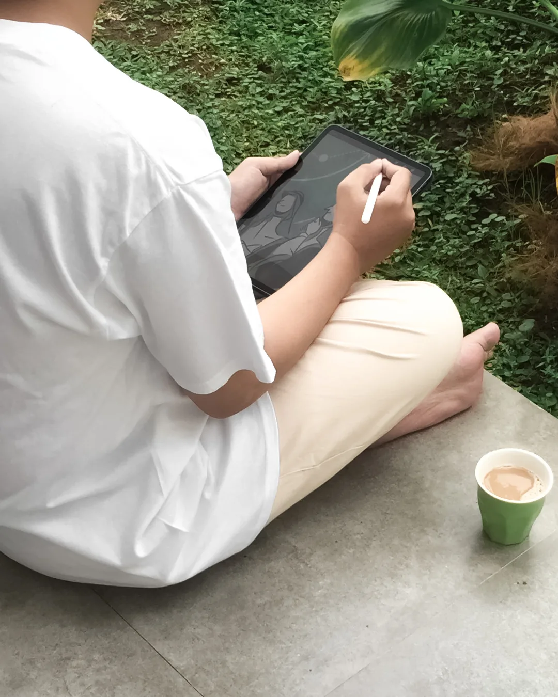
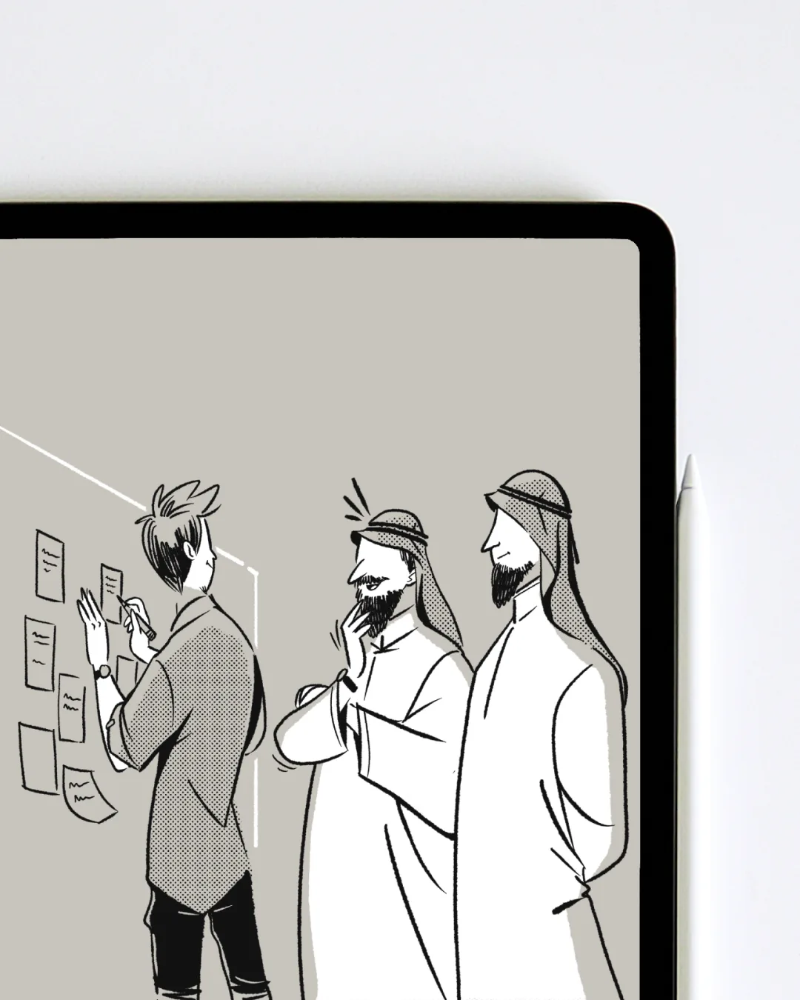
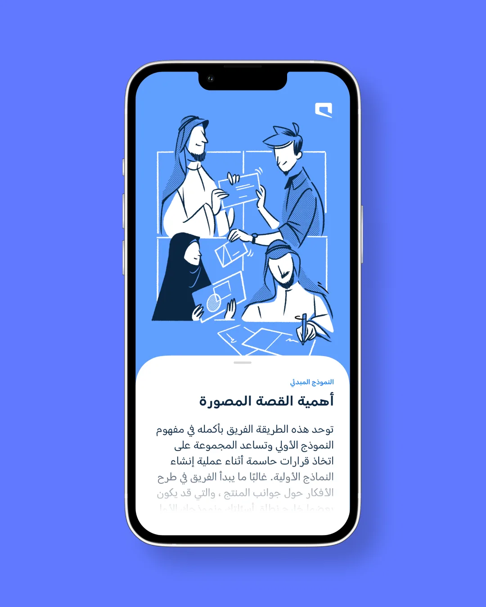
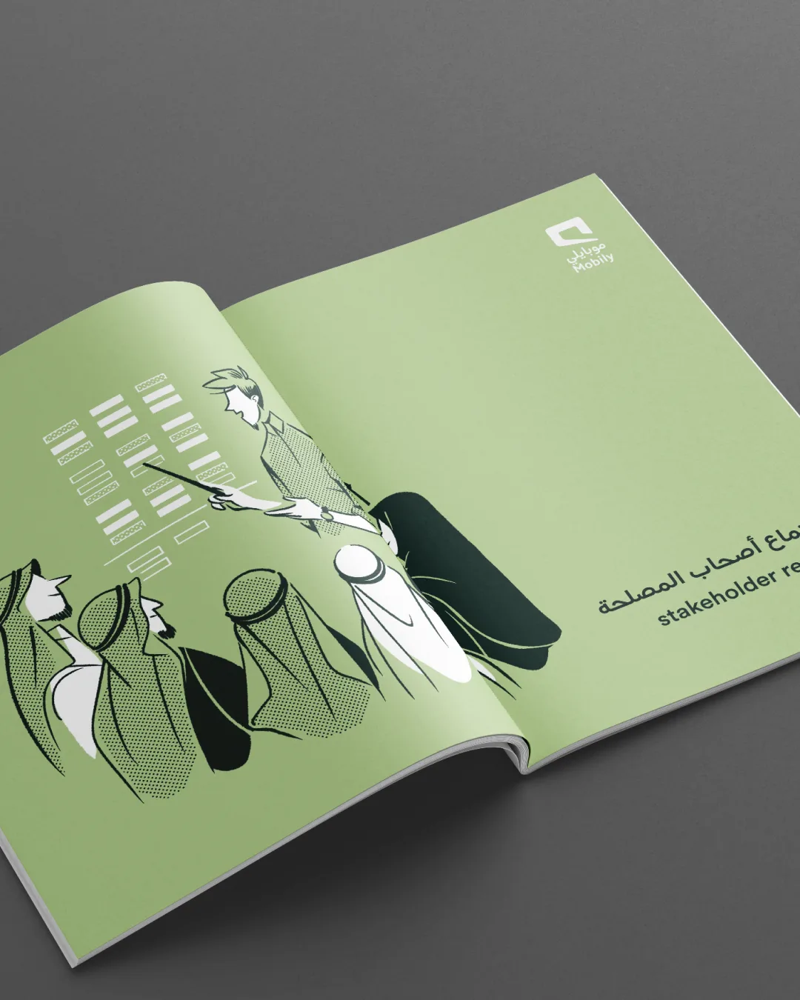
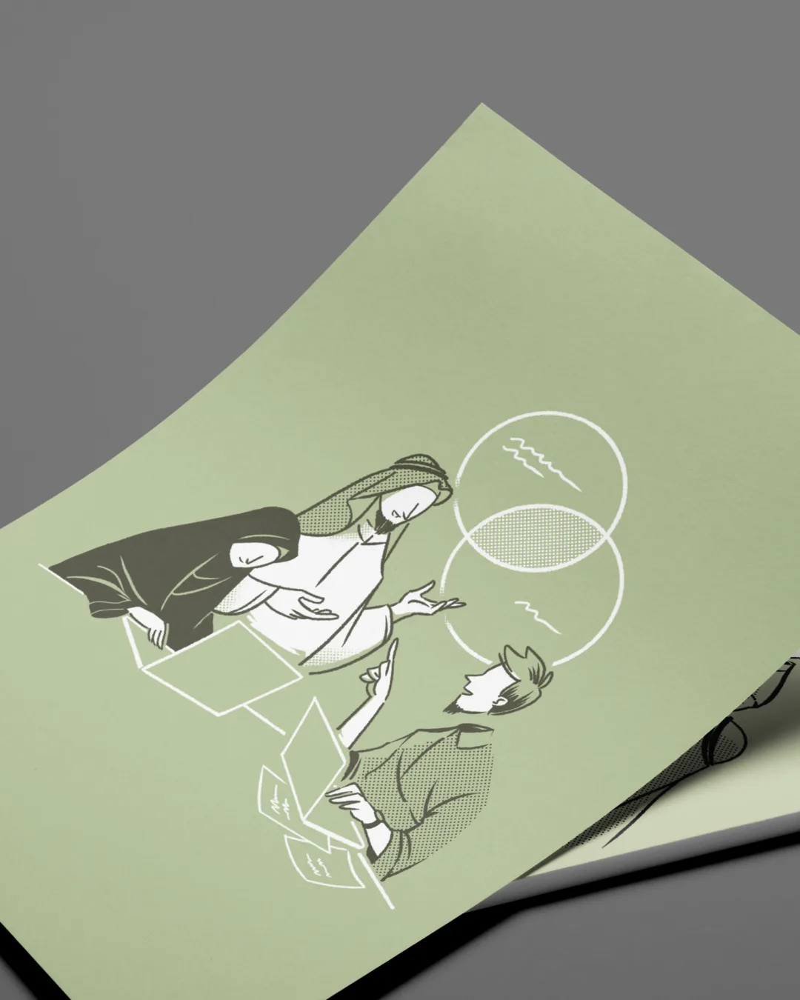
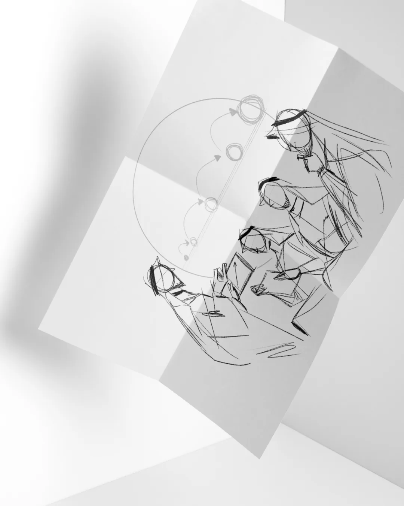
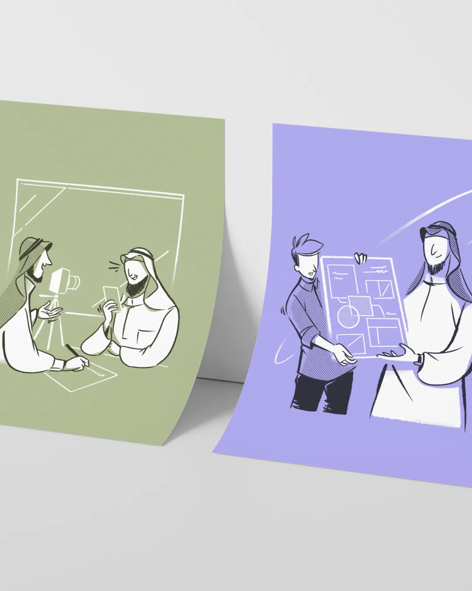
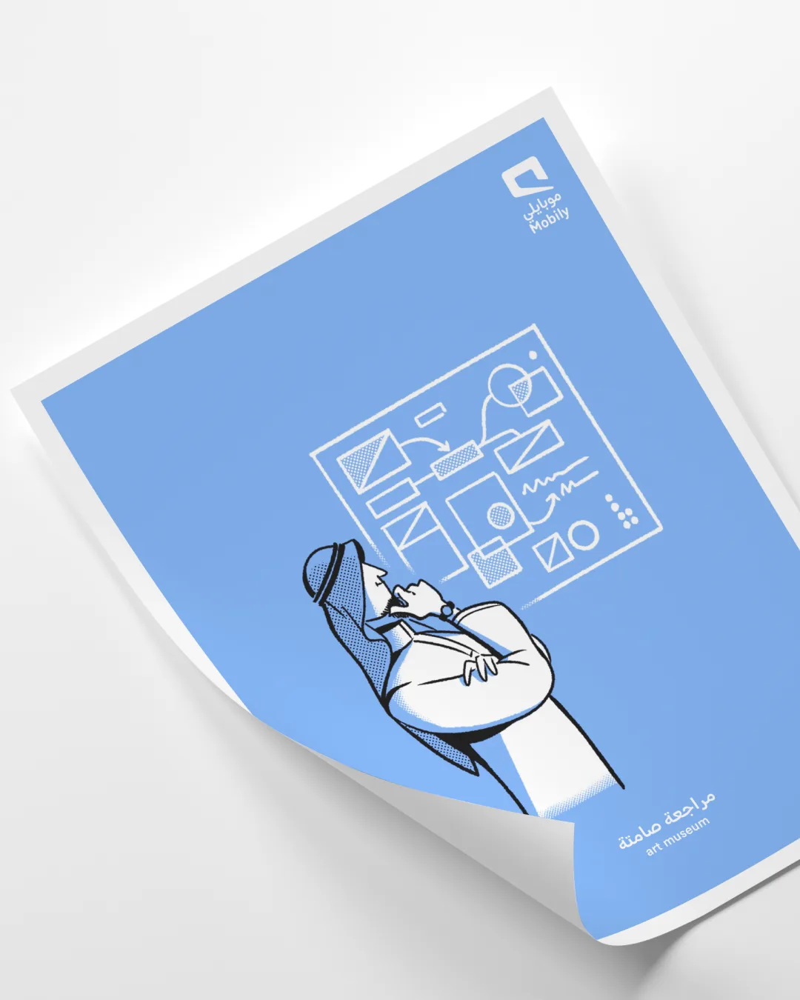

## Overview

Visualizing the intricate synergy of the Customer Experience (CX) realm at Mobily—a leading Saudi-based telecommunications service provider—with its myriad processes and unique intricacies within the workspace was an intriguing endeavor. At its core, the CX Department comprises multifaceted teams that oversee every interaction point between Mobily's valued customers and the brand itself.

Dubbed as "The Process," this series of illustrations draws inspiration from the Sprint Methodologies embraced by Mobily. The characters portrayed in the artwork are a reflection of the team leaders, deliberately stylized in formal Arabic attire, harmonious blend of tradition and modernity. The use of gritty strokes and an unfinished aesthetic conveys a message, the CX team's relentless commitment to trial and error—an ongoing quest for perfection. The visuals are presented with a super-clean and minimalistic style, employing a limited color palette to evoke a sense of clarity and purpose.

---

