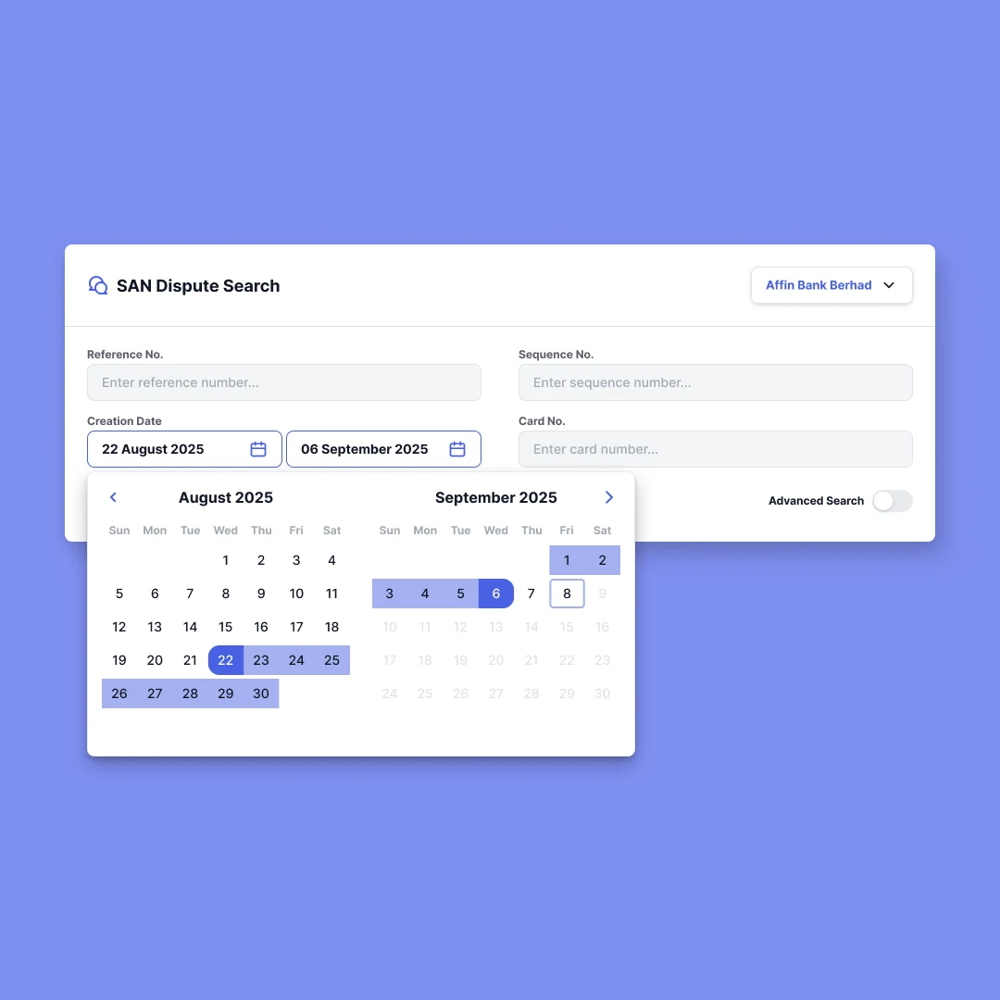
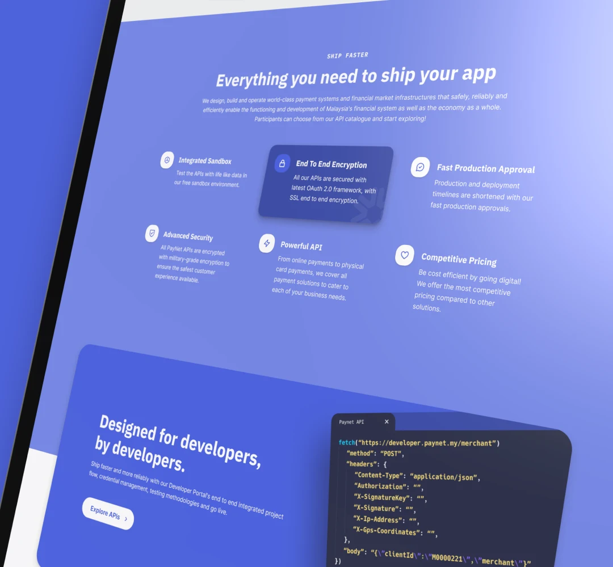
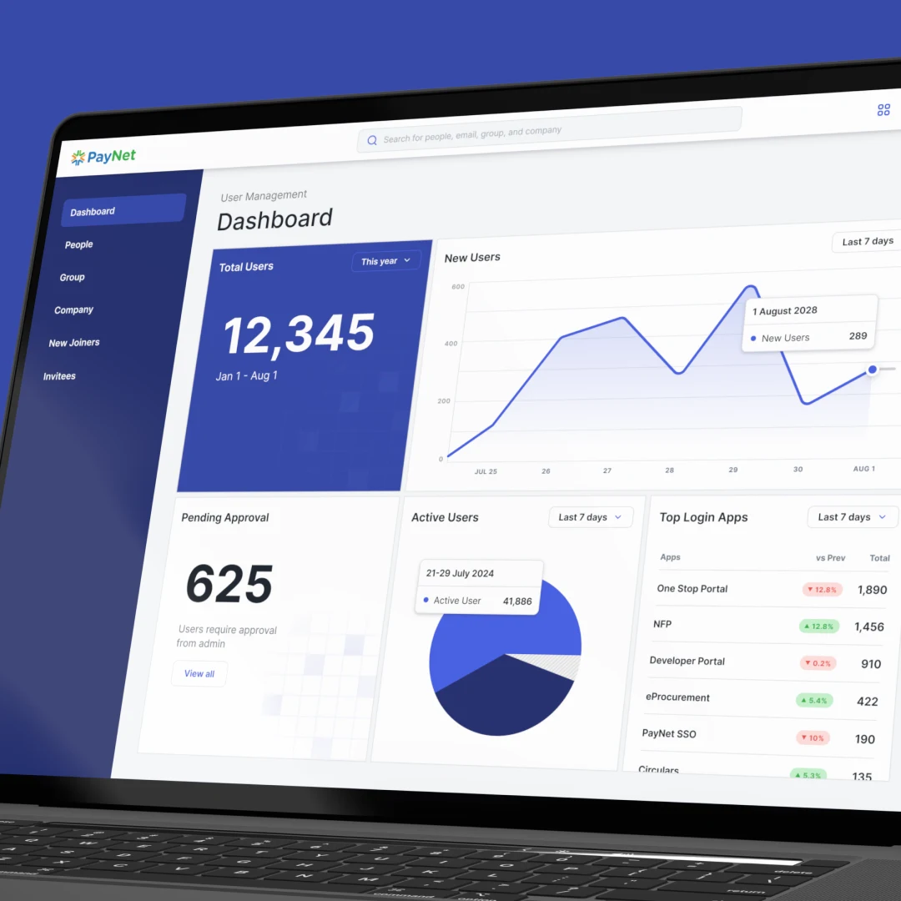
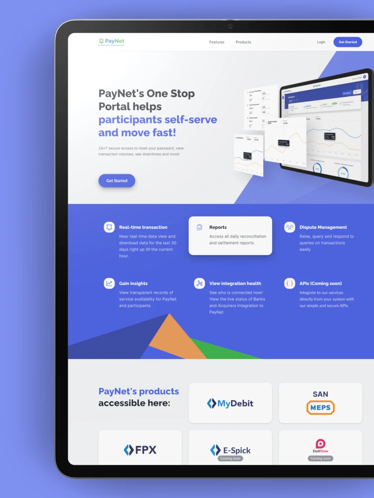
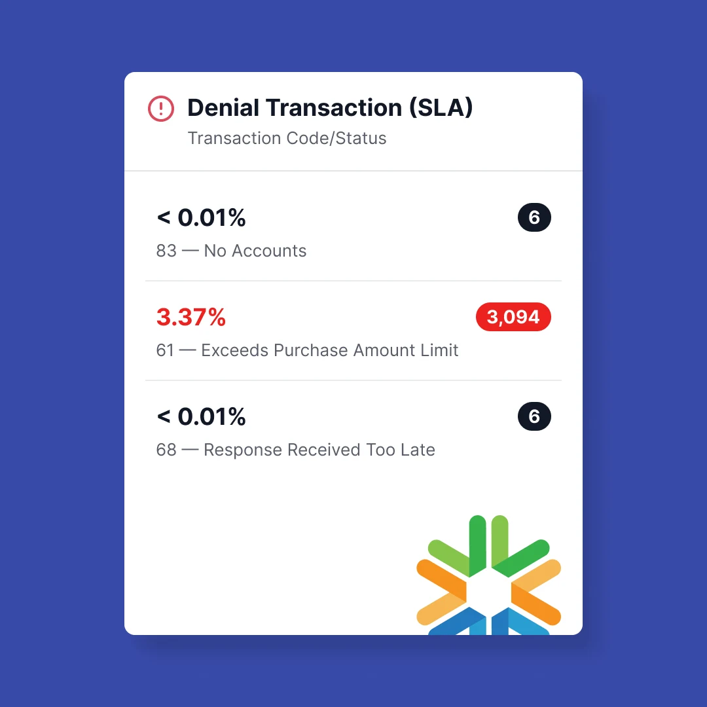
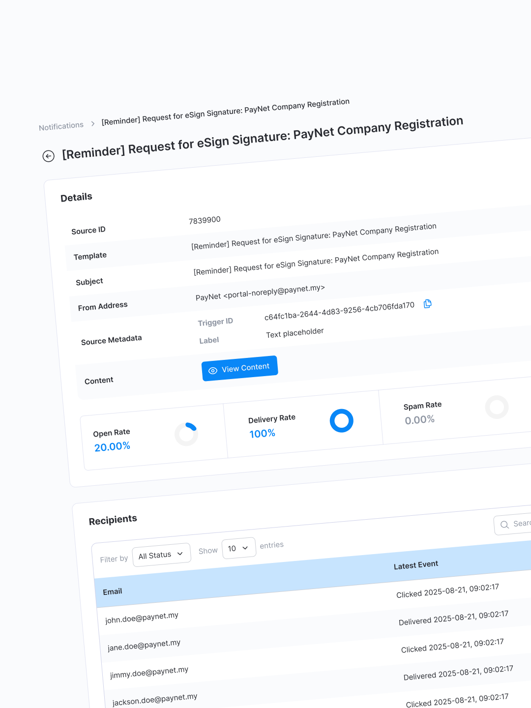
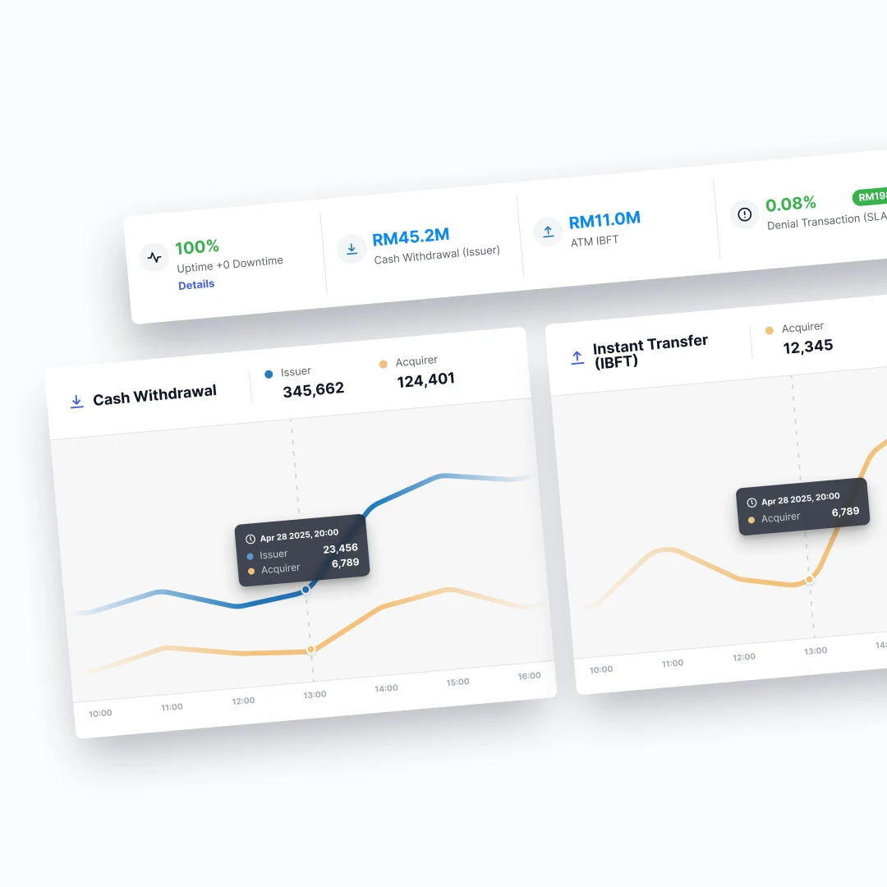
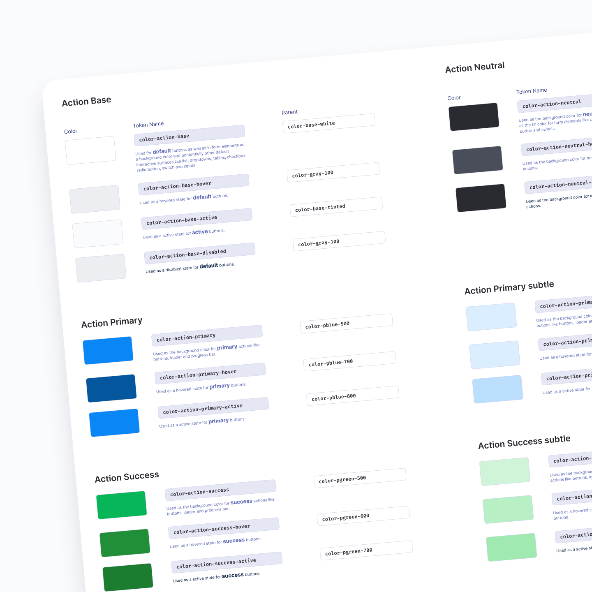
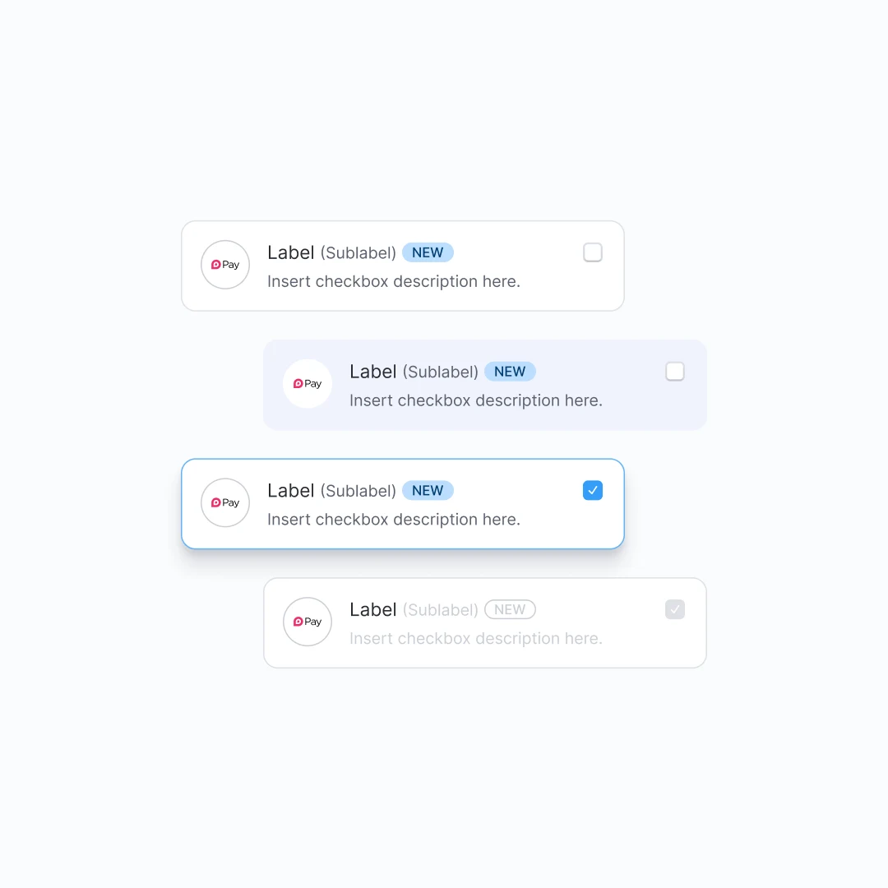

## Overview

PayNet (Payments Network Malaysia) operates the shared infrastructure that powers Malaysia's digital payments ecosystem. It is the invisible backbone—supporting systems like DuitNow, FPX, JomPAY, and the national ATM and debit networks—used daily by banks, fintechs, and merchants.

The One Stop Portal serves as PayNet's enterprise control tower for banks, providing dashboards for transaction monitoring, service availability, raised disputes, and SSO-based account management. Its primary users are operations, compliance, IT, and payments teams.

The platform had evolved through years of incremental changes without a unified information hierarchy or design system, resulting in fragmented experiences that slowed down daily operational decision-making.

---

## The Challenge

Designing for PayNet came with non-negotiable constraints: enterprise-grade security, zero tolerance for ambiguity, and regulatory sensitivity. These realities shaped every design decision—from information hierarchy to interaction patterns.

---

To ground the redesign in real operational needs, I began with a comprehensive UX audit of the existing One Stop Portal and its related systems. This involved reviewing each screen and workflow individually, covering SSO flows, dashboards, service availability, transactions, disputes, documents, and certificates.

By evaluating information hierarchy, interaction patterns, copy, and visual consistency screen by screen, I identified areas of design debt, redundancy, and friction that had accumulated over years of incremental changes. The audit informed which patterns should be preserved for familiarity, which needed refinement, and where a structural redesign was necessary to improve clarity and scalability.

---

